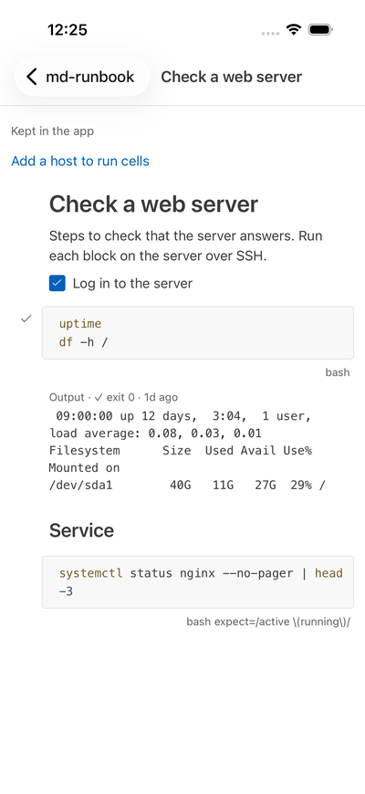
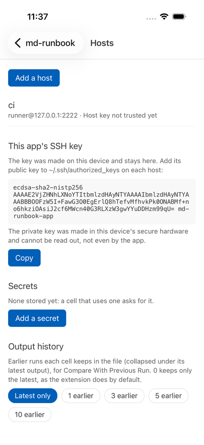
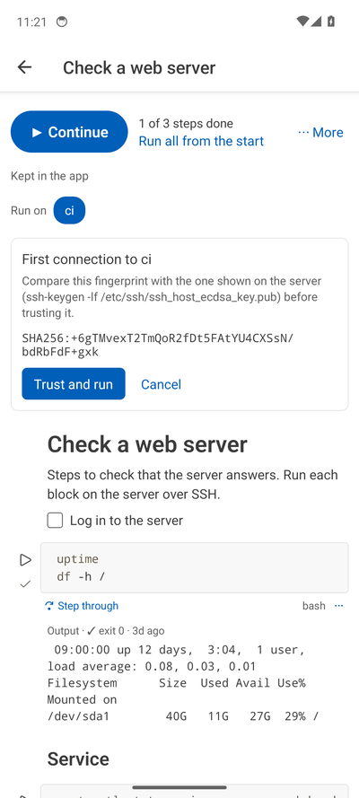
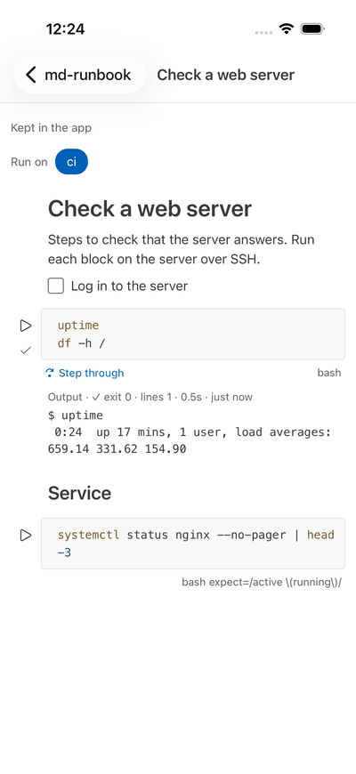
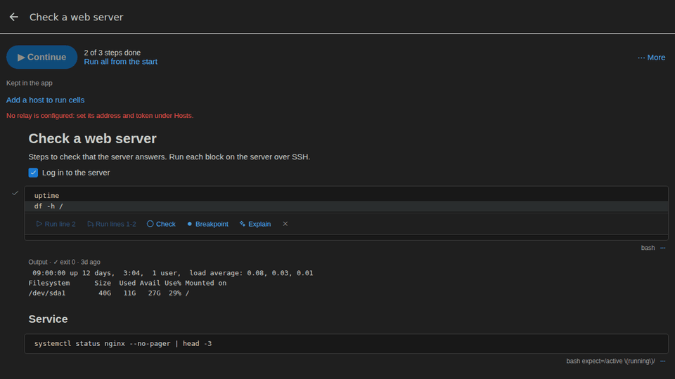
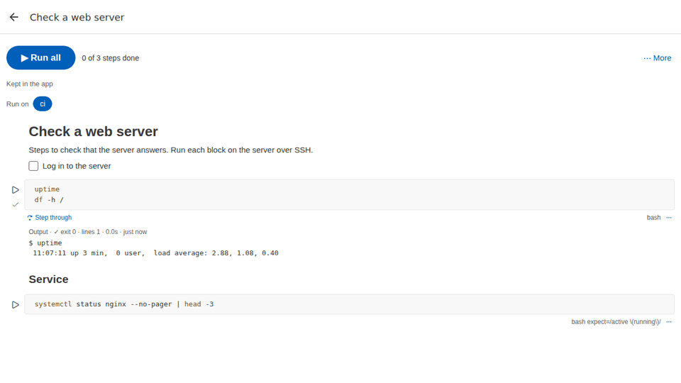
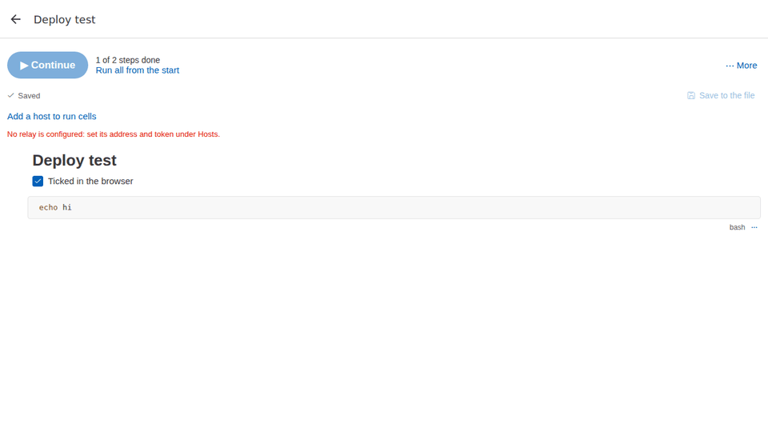

# The md-runbook app

The app runs runbooks on your servers over SSH from an iPhone, an Android phone or a browser.
It reads and writes the same Markdown files as the VS Code extension, with the same output
blocks, so a runbook can move between the two.

It is not in the App Store or Google Play yet. To try it, see [Try it](#try-it) below.

The screenshots come from the app's CI run of 2026-10-22: an iPhone simulator, an Android
emulator and Chromium, against a throwaway SSH server.

## A runbook

Runbooks look like a VS Code notebook. Markdown is rendered, and task boxes can be ticked; the
tick is written to the file. Code cells have syntax colours, their saved output and a ✓ or ✗
for the last run. The line under each cell shows its language and options. The app follows the
phone's light or dark setting, with VS Code's default colours.

## One tap to run, everything else one tap away

The top of a runbook has one button that does the obvious thing: **▶ Run all**, then
**▶ Continue** after a stop (from the failed or pending step on), **↻ Run again** when every step
is done, **■ Stop** while it runs; next to it how far the runbook is ("3 of 7 steps done · step 4
failed"). It stops at the first failure (unless the cell has `continue-on-error`), leaves
proposals out and says so, and pauses for a host key, a secret or an input as a single cell does.

**⋯ More** lists every other action in the extension's groups and names (Run, Steps, Values,
Assistant, Share, Help), each with when it matters, and a search field: type part of a name
(Ctrl/⌘+K opens it with a keyboard). A cell's **⋯**, or a long press on it, has the cell's own
actions: Run Cell, Step Through Lines, Mark Step Done / Skipped, Clear Outputs Above / Below,
Explain Output, Approve / Reject a proposal. The [cheat sheet](cheatsheet.md) has them all.

## Assistant, proposals and reports

- **Assistant** (⋯ More → Assistant): Suggest Next Steps, Explain Output, Summarize Incident
  with Claude and your own Anthropic API key (kept in the phone's keychain). As in the
  extension, nothing is sent before you confirm, with the size, the leak check and a preview;
  outputs are redacted and names pseudonymized with a map that stays on the device; suggestions
  arrive as proposed cells. **Copy for AI** and **Paste AI Proposal** work with any chat
  assistant through the clipboard; **Check for Leaks** lists secrets and internal names in the
  runbook.
- **Proposals** never run until approved on this device. **Approve** uses the extension's
  built-in command policy: allowed commands in one tap, others after typing `run`, denied ones
  not at all. The card says which account the cell will run as.
- **Share**: Export Report (HTML or PDF) and Share Runbook through the share sheet; in a browser
  the report downloads and the PDF goes through print.

## Hosts and the app's key

**Hosts & settings** is the gear at the top right of the start screen. You add each server once
there: a name, its address and the user to log in as. The app makes its own
SSH key on first use. On phones the private key is made inside the secure hardware (the Secure
Enclave on iPhones, Android Keystore) and can't be read out, not even by the app. You copy the
public key into `~/.ssh/authorized_keys` on each server, or let **Install my key…** (on a host)
do it: it logs in once with that account's password, after checking the server's key, adds the
public key and forgets the password. The app never stores a password or reads a private key
file.

- **Face ID or a fingerprint** (Hosts & settings → This app's SSH key): each SSH login and each
  signature asks for it, enforced by the phone's hardware, so a lost phone can't use the key.
  Turning it on or off makes a new key: put its public key on your hosts again.
- **A passkey** (the web app, Hosts & settings → **Use a passkey**): the key is then a passkey
  for the web app's site, kept by Windows Hello, Touch ID, your phone or a security key. The
  browser never hands it to the app, and each SSH login and each signature asks for your
  fingerprint, face or PIN. Its line starts with `verify-required`, so the server also refuses a
  signature made without that check. It needs a page the browser trusts (https), and hosts with
  OpenSSH 8.4 or newer; nothing changes on the server. Without it, the web app keeps its key in
  the browser's storage for the site.
- **Groups**: give hosts a group (a customer, a site, a team); Hosts & settings filters by group,
  and a cell's ⋯ → **Run on a Group…** runs it on each host of a group in turn, with a section per
  host in the output (hosts whose key isn't trusted yet are skipped, with a note).
- **Share hosts**: the listed hosts (one group, when one is picked) as a `hosts.json` file or a QR
  code, for a colleague's app; **Import…** (or Scan a code) shows the list first, leaves hosts with
  names you have alone, and trusts the sender's host keys only if you say so. A list never holds
  a private key: each phone puts its own public key on the hosts.

## Trusting a server

On the first connection the app shows the server's fingerprint and waits until you trust it.
Nothing is sent before that. If a trusted server later shows a different key, the app stops and
says so.

## Running cells and lines

The ▷ beside a cell runs it in a shell on the selected host; the shell stays open between
cells, as in the extension's session mode. Each runbook has its own shell on a host, so one
runbook can't read another's secrets or change the commands its cells run with. Tapping a line
opens its actions:

- **Run line**, **Run lines 1-N** and **Run lines N-end**.
- **Step from here**, or **Step through** for the whole cell. A command runs, then the app waits
  before the next one, with **Run next** and **Continue**.
- **Check**, to mark lines and run only those.

A cell with `retry=` runs again until it passes, `every=` apart, as in the extension: the cell
says which attempt is running, or when the next starts, and Stop ends the wait; only the last
attempt's output is kept (`attempts=`). A risky command (`delete`, `apply`, `rm -rf`, `helm
upgrade`, …) or the `confirm` option shows a card under the cell, and the cell runs only after
**Run**; Run All waits there, and stops if you cancel. A runbook's `no-confirm` counts only when
**Hosts & settings** allows it ([safety](features/safety.md)).

The output block records which lines ran (`lines=`), as the extension writes it. A runbook with
`kube-context:` runs a cell only while kubectl on the host is on that cluster
([Kubernetes](features/kubernetes.md), where the ops host keeps cluster access off the phone). A cell with
`host=NAME` runs on that host, whichever one is selected; the first time a runbook sends a cell
to a host other than the selected one, the app asks (a runbook from a link could otherwise
choose your production server), and an approval card names the host the cell runs on.

The app runs `sh` and `bash` cells on Linux and macOS servers, and `pwsh`, `powershell` and `cmd`
cells on Windows servers (OpenSSH Server, the Windows feature). Nothing to set up: on a Windows
server the app finds Windows PowerShell by itself, and **Hosts** shows what each server runs
after the first connection. As in VS Code, PowerShell cells share one session (variables,
functions and the folder carry over) and `cmd` cells each run in a `cmd.exe` of their own.
`os=` blocks follow the server: `os=windows` runs on Windows servers, `os=linux,macos` on the
others. A cell for the other kind of server shows why it doesn't run there.

## In a browser, through the relay

A browser can't open SSH connections, so the web app goes through a small relay you run
yourself ([apps/relay](../apps/relay/README.md)). SSH still runs in the browser: the relay only
sees encrypted traffic, and it only connects to the servers on its list.

## Parameters, secrets and inputs

As in the extension, a value never becomes part of the script: `${param:NAME}`,
`${secret:NAME}` and `${input:NAME}` run as `${NAME}` and the value is passed in the
environment.

- **Parameters:** a runbook whose cells use `${param:NAME}` shows a **Parameters** card, one
  field per parameter with the front matter's default as placeholder. The values are
  remembered per runbook.
- **Secrets:** the first time a cell needs `${secret:NAME}`, the app asks for it (masked) and
  stores it in the phone's Keychain or Keystore (in the browser: the app's local storage, like
  its key), for every runbook. **Hosts & settings → Secrets** lists the stored names and forgets them.
- **Inputs:** `${input:NAME}` is asked for the first time a cell needs it and kept while the
  runbook is open. Names ending in `_PASSWORD`, `_TOKEN` or `_SECRET`, and
  `${input:NAME:secret}`, are masked.
- Secret values are redacted from the live output and from the saved output block.
- **Captured values:** a cell with `capture=NAME` keeps a value from its output for this
  session, and later cells use it as `${out:NAME}` (`capture-secret=` values are redacted). As
  in the extension, your own cells don't use a value an assistant's cell captured.
- **Breakpoints:** tap a line → **Breakpoint** (a red dot). The cell then runs command by
  command and pauses before it: **Run next** goes one command on, **Continue** to the next
  breakpoint. Breakpoints last while the runbook is open.

## Signed runbooks

A runbook signed with **Sign Runbook** or `md-runbook sign` shows which version is signed, and
any blocks changed since. The signer's name is only what the file says until a gate has checked
the signature; then the banner shows the signer that gate accepted. On a server whose key is
restricted to md-runbook-gate, the app runs
the signed blocks by their number in the signed manifest, and the gate refuses anything else;
the app finds the gate by itself. See [signed runbooks](features/signed-runbooks.md).

**Sign Runbook** and **Co-sign Runbook** (⋯ More) sign with the app's own key, inside the phone's
secure hardware: a card at the top asks what VS Code asks (a name and scopes the first time, days
of validity, a pattern for each value a signed block uses), or shows the blocks you co-sign. Under
**Hosts & settings → Signing runbooks** you set your name for signatures and copy the key's line
for the servers' `allowed_signers`.

## Saving

The app keeps every runbook you open, with its outputs, until you remove it. A runbook opened
from a file stays linked to it, and **Save to the file** writes it back. That works on Android,
on iOS, and in Chrome and Edge; other browsers download the file instead. If the file changed
elsewhere since it was opened, the app asks whether to overwrite it or load that version.

**Open a link…** on the start screen opens a runbook from an `https` address (a GitHub or
GitLab file page works too), and runbook links (`mdrunbook://open?…`, what VS Code's **Open in
the App** copies, a pager alert, a co-sign request) open it directly, with the host and
parameter values they name; nothing runs from a link, and the runbook says whether it is signed.
The same link opened again (each click on an alert's link) opens the same copy with the new
values, as long as the runbook at that address is unchanged; **Start Incident** makes a copy per
incident.
**Scan a code** opens the same from a QR code (a label on a machine, VS Code's **Make QR Code**),
and **⋯ More → Share → Show QR Code** shows a code of this runbook for another phone.
**⋯ More → Share Runbook** hands the file on. More in
[Moving between VS Code and the app](switching.md#runbook-links).

## Try it

- **Web:** `cd apps/mobile && npm ci && npx expo start --web`. To run cells, also start the relay
  ([its README](../apps/relay/README.md)) and set its address and token under **Hosts**.
- **Android or iOS:** `npx expo run:android` or `npx expo run:ios` in `apps/mobile` builds the
  app for an emulator or a connected device. The phone builds need the Android SDK or Xcode.
- **Store builds:** not published yet. The steps are in [apps/mobile/STORE.md](../apps/mobile/STORE.md).

## Not there yet

- The app is in English only; its texts are in one file (`apps/mobile/src/i18n.ts`), ready for
  translation.
- The web app isn't hosted by md-runbook yet: it needs its own domain, because it keeps its SSH
  key in the site's local storage, which any other site served from the same address could
  read. To host it yourself, the release publishes it as a container
  ([apps/web](../apps/web/README.md)).
- Signed runbooks: no secret values in signed cells; signing in the app doesn't check each
  command with `bash -n` as VS Code and the command line do ([details](features/signed-runbooks.md)).
