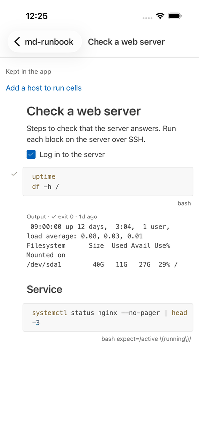
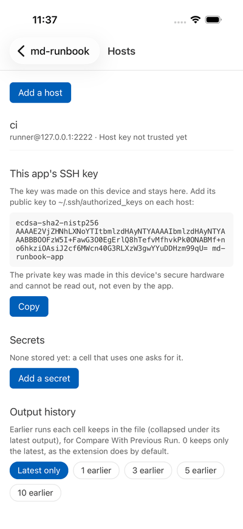
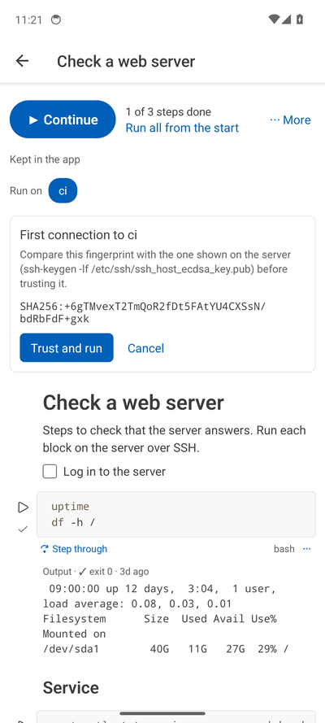
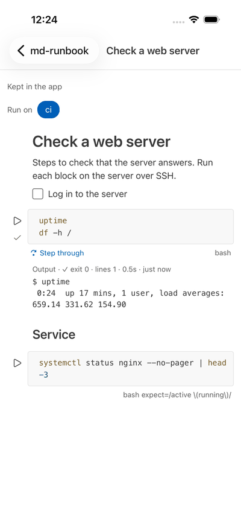
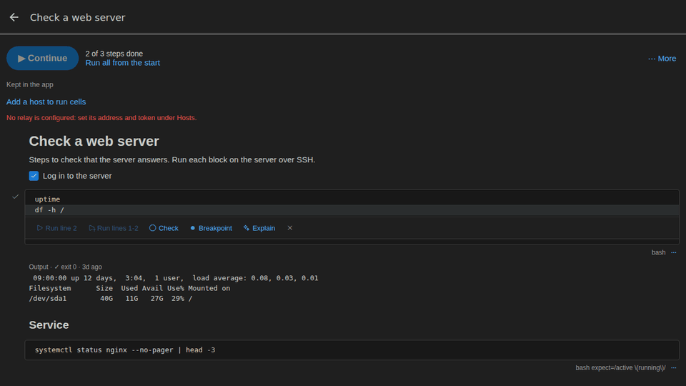
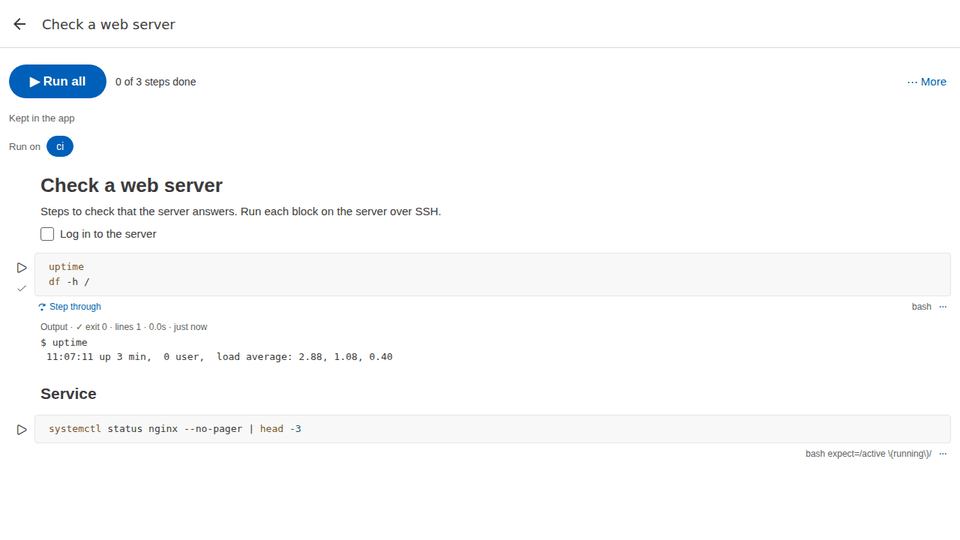
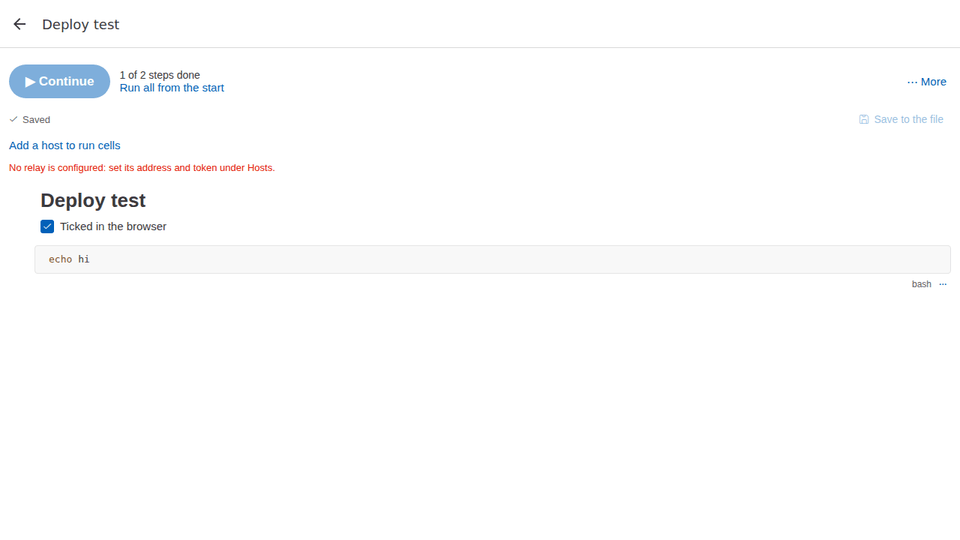

# The md-runbook app

The app runs runbooks on your servers over SSH from an iPhone, an Android phone or a browser.
It reads and writes the same Markdown files as the VS Code extension, with the same output
blocks, so a runbook can move between the two.

It is not in the App Store or Google Play yet. To try it, see [Try it](#try-it) below.

The screenshots come from the app's CI run of 2026-10-22: an iPhone simulator, an Android
emulator and Chromium, against a throwaway SSH server.

## A runbook

Runbooks look like a VS Code notebook. Markdown is rendered, and task boxes can be ticked; the
tick is written to the file. Code cells have syntax colours, their saved output and a ✓ or ✗
for the last run. The line under each cell shows its language and options. The app follows the
phone's light or dark setting, with VS Code's default colours.

## One tap to run, everything else one tap away

The top of a runbook has one button that does the obvious thing: **▶ Run all**, then
**▶ Resume** after a stop (from the failed or pending step on), **↻ Run again** when every step
is done, **■ Stop** while it runs; next to it how far the runbook is ("Step 4 of 7 · Push image"
while it runs, "Step 4 of 7 failed", "Done · 7 of 7"), and by the blocks' estimates the share
done, the time left and when it ends ("41% · 4 min left · ≈ 14:32"). It stops at the first
failure (unless the cell has `continue-on-error`), leaves proposals out and says so, and pauses
for a host key, a secret or an input as a single cell does. Scrolled down during a run, a slim
bar on top keeps the step and Stop in view.

**Run all waits at a step done by hand**: a checklist item that isn't ticked (`- [ ]`) between
the block before and the next one. A card under it asks **Done by hand?** with the item's text:
**Done** ticks the box in the runbook and goes on, **Skip** goes on without ticking it, **Stop**
ends the run there (Resume asks again). The run bar says the run waits for you, and **↓
Answer** goes to the card. Ticked items never wait, items after the last block are asked once
the run gets there, and a single cell's ▷ never waits. `manual-steps: continue` in the front
matter turns this off (the items are then reminders), as in VS Code ([syntax](syntax.md#steps-and-progress)).

**Runbook | Steps.** On a phone (or a browser window narrower than 900 px) a switch at the top,
under the title, shows either the runbook or its **Steps**. It stays at the top while the
runbook scrolls, is remembered for each runbook, and never switches by itself: while the run
waits for you, **Steps** has a dot. The run bar's headline (it has a ›), a tap on the rail and
⋯ More → **Show Steps** switch to Steps; going back to the runbook finds it where you left it.

**Steps** is the same view as VS Code's Runbook Steps view. At the top, where the run is (the
run bar's words), the bar, the share and the time left, and **▶ Run all** / **■ Stop** (on a
phone, where the run bar is out of sight). After a failure it says **Step N of T failed** with
**Retry step** (that step again) and **Resume** (it and the steps still to do). Before a run,
**Before you run: 1 confirmation · 1 secret to set · 1 value to type · 1 step by hand**: tap a
count to go to the first step that needs it (values open **Set Inputs**, secrets the Secrets
screen). Then the `#`/`##` chapters as headings and each step with its state as a symbol and a
colour (✓ done, ✕ failed, ▶ running, ❚❚ waiting for you, ○ to do), its number, its name, its
time (`est. 2m`, `12s of 1m` while it runs, `took 3m10s (+40s)` after a run over its estimate,
`by hand` for a checklist item), what it will need (`needs your confirmation`) and, for a
failed step, the last line of its error (stderr, else its output). The ready check says what
it answered and a teardown not run yet says *offered*.

- **Tap a row** to see the step in the runbook (on a phone, the switch goes to Runbook).
- **Long press a row** for the step's actions, the same as its cell's ⋯: Run Cell, Run from
  Here, Run Until Here (from the first step still to do up to this one), Mark Step Done /
  Skipped, Unmark Step and the others. A screen reader offers them as the row's actions.
- **A checklist item has a tick box**; ticking the one Run all waits at counts as Done.
- **The step the run waits at has the question's answers** as buttons, the same as the card
  under its cell: **Done** / **Skip** / **Stop** for a step done by hand, **Take down** /
  **Leave it up** for the teardown, **Run** / **Cancel** for a confirmation (with the command
  and where it runs). A question you type into (a value, a secret, a new host key) has
  **Answer**, which shows its card in the runbook.

**The rail on the left** shows the whole runbook at once and stays beside the runbook on a
phone: it fills from the top as the run goes down, with a tick per step where it is in the
runbook (green done, red failed, pulsing while it runs, still with Reduce Motion), a crossbar
per `#`/`##` chapter and a pale box for the part on screen. Tap it for Steps; press and drag
along it and a bubble names the chapter and the step under your finger, let go to go there. Its
touch strip is 44 px wide, beside the cells rather than over them; the scrubber follows up and
down only, so a sideways swipe from the edge stays the system's back gesture.

**On a wide screen** (a tablet, a browser window 900 px or wider) there is no switch: Steps is a
panel on the left instead of the rail, always open, with the cells on screen shaded and the
running step in view, and the same header, rows and buttons (Run all stays in the run bar
beside it); the runbook keeps a readable width instead of stretching across the window.

**⋯ More** lists every other action in the extension's groups and names (Run, Steps, Values,
Assistant, Share, Help), each with when it matters, and a search field: type part of a name
(Ctrl/⌘+K opens it with a keyboard). A cell's **⋯**, or a long press on it, has the cell's own
actions: Run Cell, Run from Here, Run Until Here, Step Through Lines, Mark Step Done / Skipped, Clear Outputs Above / Below,
Explain Output, Approve / Reject a proposal. The [cheat sheet](cheatsheet.md) has them all.

## Assistant, proposals and reports

- **Assistant** (⋯ More → Assistant): Suggest Next Steps, Explain Output, Summarize Incident
  with Claude and your own Anthropic API key (kept in the phone's keychain). As in the
  extension, nothing is sent before you confirm, with the size, the leak check and a preview;
  outputs are redacted and names pseudonymized with a map that stays on the device; suggestions
  arrive as proposed cells. **Copy for AI** and **Paste AI Proposal** work with any chat
  assistant through the clipboard; **Check for Leaks** lists secrets and internal names in the
  runbook.
- **Proposals** never run until approved on this device. **Approve** uses the extension's
  built-in command policy: allowed commands in one tap, others after typing `run`, denied ones
  not at all. The card says which account the cell will run as.
- **Share**: Export Report (HTML or PDF) and Share Runbook through the share sheet; in a browser
  the report downloads and the PDF goes through print.

## Hosts and the app's key

**Hosts & settings** is the gear at the top right of the start screen. You add each server once
there: a name, its address and the user to log in as. The app makes its own
SSH key on first use. On phones the private key is made inside the secure hardware (the Secure
Enclave on iPhones, Android Keystore) and can't be read out, not even by the app. You copy the
public key into `~/.ssh/authorized_keys` on each server, or let **Install my key…** (on a host)
do it: it logs in once with that account's password, after checking the server's key, adds the
public key and forgets the password. The app never stores a password or reads a private key
file.

- **Face ID or a fingerprint** (Hosts & settings → This app's SSH key): each SSH login and each
  signature asks for it, enforced by the phone's hardware, so a lost phone can't use the key.
  Turning it on or off makes a new key: put its public key on your hosts again.
- **A passkey** (the web app, Hosts & settings → **Use a passkey**): the key is then a passkey
  for the web app's site, kept by Windows Hello, Touch ID, your phone or a security key. The
  browser never hands it to the app, and each SSH login and each signature asks for your
  fingerprint, face or PIN. Its line starts with `verify-required`, so the server also refuses a
  signature made without that check. It needs a page the browser trusts (https), and hosts with
  OpenSSH 8.4 or newer; nothing changes on the server. Without it, the web app keeps its key in
  the browser's storage for the site.
- **Groups**: give hosts a group (a customer, a site, a team); Hosts & settings filters by group,
  and a cell's ⋯ → **Run on a Group…** runs it on each host of a group in turn, with a section per
  host in the output (hosts whose key isn't trusted yet are skipped, with a note).
- **Share hosts**: the listed hosts (one group, when one is picked) as a `hosts.json` file or a QR
  code, for a colleague's app; **Import…** (or Scan a code) shows the list first, leaves hosts with
  names you have alone, and trusts the sender's host keys only if you say so. A list never holds
  a private key: each phone puts its own public key on the hosts.

## Trusting a server

On the first connection the app shows the server's fingerprint and waits until you trust it.
Nothing is sent before that. If a trusted server later shows a different key, the app stops and
says so.

## Running cells and lines

The ▷ beside a cell runs it in a shell on the selected host; the shell stays open between
cells, as in the extension's session mode. Each runbook has its own shell on a host, so one
runbook can't read another's secrets or change the commands its cells run with. As there, `exit N`
in a cell ends the shell: the cell gets exit code N and the next cell starts in a new shell (use
`return N` to leave a cell early and keep the shell). Tapping a line
opens its actions:

- **Run line**, **Run lines 1-N** and **Run lines N-end**.
- **Step from here**, or **Step through** for the whole cell. A command runs, then the app waits
  before the next one, with **Run next** and **Continue**.
- **Check**, to mark lines and run only those.

A cell with `retry=` runs again until it passes, `every=` apart, as in the extension: the cell
says which attempt is running, or when the next starts, and Stop ends the wait; only the last
attempt's output is kept (`attempts=`). A risky command (`delete`, `apply`, `rm -rf`, `helm
upgrade`, …) or the `confirm` option shows a card under the cell, and the cell runs only after
**Run**; Run All waits there, and stops if you cancel. A runbook's `no-confirm` counts only when
**Hosts & settings** allows it ([safety](features/safety.md)).

The output block records which lines ran (`lines=`), as the extension writes it. A runbook with
`kube-context:` runs a cell only while kubectl on the host is on that cluster
([Kubernetes](features/kubernetes.md), where the ops host keeps cluster access off the phone). A cell with
`host=NAME` runs on that host, whichever one is selected; the first time a runbook sends a cell
to a host other than the selected one, the app asks (a runbook from a link could otherwise
choose your production server), and an approval card names the host the cell runs on.

The app runs `sh` and `bash` cells on Linux and macOS servers, and `pwsh`, `powershell` and `cmd`
cells on Windows servers (OpenSSH Server, the Windows feature). Nothing to set up: on a Windows
server the app finds Windows PowerShell by itself, and **Hosts** shows what each server runs
after the first connection. As in VS Code, PowerShell cells share one session (variables,
functions and the folder carry over) and `cmd` cells each run in a `cmd.exe` of their own.
`os=` blocks follow the server: `os=windows` runs on Windows servers, `os=linux,macos` on the
others. A cell for the other kind of server shows why it doesn't run there.

**Hosts & settings → Output history** sets how many earlier outputs each cell keeps in the file,
collapsed under its latest one, for **Compare With Previous Run**; **Latest only** keeps none, as
the extension does by default. **Cloud console lists** turns AWS and Google Cloud JSON output
(EC2, EKS, Compute Engine, GKE, Cloud Run) into a list with a link to each resource in the
console.

## Notifications

The first **Run all** offers a notification when a run is done, fails or waits for you (a value
to type, a risky command to confirm, the teardown offer, a step done by hand) while the app is
in the background, or, in a browser, while the tab is hidden. The system asks for the permission
only after **Notify me**; **Not now** isn't asked again, and **Hosts & Settings → Notifications**
turns them on or off. They say what the run bar says ("Deploy checkout" · "Step 4 of 6 failed —
Push image"), and a tap opens the runbook at that step. Nothing leaves the device: they are local
notifications, not push.

A phone doesn't keep a backgrounded app running. iOS suspends md-runbook about half a minute after
you leave it (the time it asks for while a cell runs), and Android 14 and later freeze it about ten
seconds after it is cached, closing its connections. A run in progress stops there; the step that
was running may be cut off with its connection. So when you leave the app during a run, it
schedules a notification for about then that says the run is paused; if the run ends or waits
first, that one is taken back and you get the result instead. Back in the app, the run shows where
it stopped, and **▶ Resume** goes on. A browser keeps a hidden tab running (more slowly),
so the web app has no paused notification.

## In a browser, through the relay

A browser can't open SSH connections, so the web app goes through a small relay you run
yourself ([apps/relay](../apps/relay/README.md)). SSH still runs in the browser: the relay only
sees encrypted traffic, and it only connects to the servers on its list.

**Hosts & settings → Relay (web)** holds the relay's address and token.

- **This server's relay:** when the web app's own address answers `/v1/server-info` as a relay
  (a proxy or tunnel that sends `/v1/` to the relay, next to the web app), the address is filled
  in and shown as "this server's relay". You still enter the token. An address you set yourself
  is never replaced by it.
- **The token** travels as a WebSocket subprotocol, so only letters, digits and `-._~!#$%&'*+^|`
  work: make one with `openssl rand -hex 32`.

### Pairing a phone's browser

To use the web app in a phone's browser (through a tunnel, for example) without typing the token
on the phone:

1. **On the laptop**, open Hosts & settings → Relay → **Pair a device**. It shows a QR code with
   the relay's address and token, and, with **With the hosts and their trusted host keys**, your
   hosts. The code holds a secret: anyone who scans it can use your relay. Show it only to your
   own device. It hides itself after a minute (**Show again**). **Copy pairing link** copies the
   same as a link, `https://<web app>/pair#mdrb-pair.v1.…`, to open on the phone instead.
2. **On the phone**, open the web app at its public address, then Hosts & settings → Relay →
   **Pair with another device**, and scan the code. Or open the pairing link.
3. The phone asks **Set up the relay from this code?** (or **…from this link?**) and shows the
   relay and the hosts. Hosts with a name it already has are left alone. Their host keys are
   trusted only if you tick **Trust the host keys in this list**, as for an imported hosts list.
4. Then it shows **This device's key** with **Copy** and as a QR code: **Add this key to the
   server's authorized_keys**. The browser makes its own key, and the app can't put it on a
   server you log in to without a password, so whoever looks after the server adds that line.
5. **The signers, to compare.** When the laptop trusts signers of a team library, the code also
   carries, per library, its address and the fingerprints of those keys (**With the signers this
   device trusts for N libraries, to compare**, on by default). The phone keeps them on **Set up**,
   never as trust. When you then press **Trust these signers** for that library on the phone, each
   key says **Your other device trusts this key** or **Your other device doesn't trust this key**,
   and the prompt says **The same keys your other device trusts for this library** or that they
   differ (a key the laptop doesn't trust, or one it trusts that the library no longer publishes):
   a library whose list changed between your two devices shows here. A link can confirm or warn
   about the keys the library publishes; it can't add one, and trusting is still your press.

The token is never in a URL's query. A pairing link carries it in the fragment, the part after
`#`, which browsers never send to a server. The app reads the fragment once, when the page loads,
and removes it from the address bar and the history (`history.replaceState`) before asking. The
browser camera needs a secure page (https, or `localhost`). On an `http://` address the app says
so: use **Copy pairing link** instead. A hosts list (Share hosts) may name the relay's address
(**With the relay's address**), never its token.

The pairing code is `mdrb-pair.v1.` followed by deflated JSON in base64url (as `rb=` links):
`{"format":"md-runbook pair v1","relay":"wss://…","token":"…","hosts":[…],"signers":[…]}`, with
`hosts` in the hosts list's format and `signers` as
`[{"library":"https://…/runbooks/","fingerprints":["SHA256:…"]}]` (at most 8 libraries, 32 keys
each; an app before 0.25.0 ignores it). The relay and a 64-character token make a 57 × 57 code (version 10). Each
host with its key adds about 300 characters, so with more than one or two hosts the code gets
large, and the card warns that a phone may not read it. 15 hosts are about the most one code
holds. For more, leave the hosts out and use Share hosts.

### The public address

Share links, QR codes and pairing links start with the web app's **public address**: the one other
devices reach it at, not the one the page was opened from. On the laptop that runs the container
the page is `http://localhost:8080`, but a phone needs the tunnel's `https://….trycloudflare.com`.
The address comes from, in order:

1. **Hosts & settings → Public address of this web app** (web), when set;
2. the container's `MD_RUNBOOK_PUBLIC_URL` ([apps/web](../apps/web/README.md#settings));
3. the page's own address.

It must be `https` (`http` only for `localhost`). Addresses on the page's own address follow it.
For example, a library copy's `http://localhost:8080/runbooks/restart.md` is linked to as
`https://<public address>/runbooks/restart.md`, and the relay `ws://localhost:8080` is handed on
as `wss://<public address>`. On an `http` page with no `https` public address, QR codes keep the
app's own `mdrunbook://open?…` links.

## Parameters, secrets and inputs

As in the extension, a value never becomes part of the script: `${param:NAME}`,
`${secret:NAME}` and `${input:NAME}` run as `${NAME}` and the value is passed in the
environment.

- **Parameters:** a runbook whose cells use `${param:NAME}` shows a **Parameters** card, one
  field per parameter with the front matter's default as placeholder. The values are
  remembered per runbook.
- **Secrets:** the first time a cell needs `${secret:NAME}`, the app asks for it (masked) and
  stores it in the phone's Keychain or Keystore (in the browser: the app's local storage, like
  its key), for every runbook. **Hosts & settings → Secrets** lists the stored names and forgets them.
- **Inputs:** `${input:NAME}` is asked for the first time a cell needs it and kept while the
  runbook is open. Names ending in `_PASSWORD`, `_TOKEN` or `_SECRET`, and
  `${input:NAME:secret}`, are masked.
- Secret values are redacted from the live output and from the saved output block.
- **Captured values:** a cell with `capture=NAME` keeps a value from its output for this
  session, and later cells use it as `${out:NAME}` (`capture-secret=` values are redacted). As
  in the extension, your own cells don't use a value an assistant's cell captured.
- **Breakpoints:** tap a line → **Breakpoint** (a red dot). The cell then runs command by
  command and pauses before it: **Run next** goes one command on, **Continue** to the next
  breakpoint. Breakpoints last while the runbook is open.

## Signed runbooks

A runbook signed with **Sign Runbook** or `md-runbook sign` shows which version is signed, and
any blocks changed since. The signer's name is only what the file says until a gate has checked
the signature; then the banner shows the signer that gate accepted. On a server whose key is
restricted to md-runbook-gate, the app runs
the signed blocks by their number in the signed manifest, and the gate refuses anything else;
the app finds the gate by itself. See [signed runbooks](features/signed-runbooks.md).

**Sign Runbook** and **Co-sign Runbook** (⋯ More) sign with the app's own key, inside the phone's
secure hardware: a card at the top asks what VS Code asks (a name and scopes the first time, days
of validity, a pattern for each value a signed block uses), or shows the blocks you co-sign. Under
**Hosts & settings → Signing runbooks** you set your name for signatures and copy the key's line
for the servers' `allowed_signers`.

### Trusted signers

**Hosts & settings → Trusted signers** is the one list of keys whose signatures the app counts,
for the team library and for [run reports](features/run-reports.md#required-and-signed-reports)
alike. Each entry says where it counts:

- **From the team library at runbooks.example.net:** a key you trusted from that library's
  `allowed_signers` (Team runbooks → **Trust these signers**). It counts for that library's
  runbooks only, and stops counting once the library no longer publishes it (flagged **No longer
  published**, also while the library can't be read).
- **Added by you:** `allowed_signers` lines you paste under **Add signers**. They count for every
  runbook: the team library's, and runbooks from files and links. The lines are in OpenSSH's
  format, as on the servers; Ed25519, ECDSA, RSA and security-key signatures are checked on the
  device.

**Remove** takes a key off the list. A runbook is **verified** only when its signature checks out
with a key that counts for it, under the name its signature block gives:

- **Whole runbook verified:** signed with manifest version 2, and the text is as signed: prose,
  front matter, checklists, PowerShell and cmd blocks included (outputs and ticked boxes aside).
- **These steps verified:** signed before manifest version 2. Only the bash blocks and runbook
  calls are signed; the text around them may have changed. Not enough to require run reports.
- **Partly signed:** signed before manifest version 2, with PowerShell or cmd blocks the
  signature doesn't cover. Not verified.
- **Changed since signing:** a block changed, or (manifest version 2) any of the text. Not verified.

## Saving

The app keeps every runbook you open, with its outputs, until you remove it. A runbook opened
from a file stays linked to it, and **Save to the file** writes it back. That works on Android,
on iOS, and in Chrome and Edge; other browsers download the file instead. If the file changed
elsewhere since it was opened, the app asks whether to overwrite it or load that version.

**Open a link…** on the start screen opens a runbook from an `https` address (a GitHub or
GitLab file page works too), and runbook links (`mdrunbook://open?…`, what VS Code's **Open in
the App** copies, a pager alert, a co-sign request) open it directly, with the host and
parameter values they name; nothing runs from a link, and the runbook says whether it is signed.
The same link opened again (each click on an alert's link) opens the same copy with the new
values, as long as the runbook at that address is unchanged; **Start Incident** makes a copy per
incident.
**Scan a code** opens the same from a QR code (a label on a machine, VS Code's **Make QR Code**),
and **⋯ More → Share → Show QR Code** shows a code of this runbook for another phone.
**⋯ More → Share Runbook** hands the file on. More in
[Moving between VS Code and the app](switching.md#runbook-links).

## Team runbooks

A team can host its runbooks in a folder on a web server (the web app's container serves one at
`/runbooks/`, [apps/web](../apps/web/README.md#a-team-library)), and the start screen lists them
under **Team runbooks**, by subfolder, each with its signature (**Signed by alice@example.net:
whole runbook verified** or **these steps verified**, **Partly signed**, **Signed, unknown
signer**, **Not signed** or **Changed since signing**: see [Trusted signers](#trusted-signers) for what
each means) and its signed name and version (`ops/restart, version 4`). The opened copy's banner
says the same, checked the same way.

- **What "verified" means:** the signature checks out with a key under **Trusted signers** that
  counts for this library (trusted from it, or added by you), and covers every block the app
  could run. **Whole runbook verified** covers the text too; **these steps verified** (signed
  before manifest version 2) the bash blocks and runbook calls only.
- **Flagged in the row:** a signed name that is not the end of the file's path (`ops/restart`
  fits `ops/restart.md`, not `restart.md` or `staging/restart.md`: a signed runbook served under
  another name), a version older than one of this file this library showed before (someone put an
  old version back), and an expired signature (which is not verified).
- **Opening one makes your copy.** Your runs and outputs stay in your copy; the file on the
  server is never changed. Opening it again opens your copy. Remove it like any runbook.
- **Update available:** when the file on the server changed, its row offers **Update** and
  **Keep mine**. Update checks the new version's signature again and takes it, keeping the
  outputs of the blocks that didn't change; it asks first when outputs would be lost, when your
  copy has changes of its own (edits, ticked boxes), or when the new version is no longer signed,
  is signed by someone else or with another key, changed since it was signed, is partly signed,
  expired, or older than your version; and asks again if the library changed while it asked. Keep
  mine hides that version until the next one.
- **A copy the library refuses** (it opens verified runbooks only, and your copy is edited, older
  than the version it has now, or no longer signed by a key you trust) is never a dead end: its
  row offers **Replace with the library's version**, and **Keep mine** is not offered when keeping
  would leave a copy the library refuses.
- **Signers:** if the library publishes an `allowed_signers` file, **Trust these signers** asks
  **Trust these keys for the team library at …?**, says in a few points what trusting them does,
  and shows each name (and what a pattern such as `*@example.net` lets a key sign as) and key
  fingerprint. The list comes from the same server as the runbooks, so it is that server
  vouching for itself: compare the fingerprints with what the signers tell you, or, on a device
  you [paired](#pairing-a-phones-browser) with another that trusts them, with what that device
  trusts (each key says so). Trust counts for that library only. Once trusted, the app checks the signatures itself; **Stop trusting** undoes
  it, and a key the library no longer publishes stops counting and is offered to forget.
  [Hosts & settings → Trusted signers](#trusted-signers) lists every trusted key with where it counts,
  and **Remove**.
- A library can open **verified runbooks only** (`"signedOnly": true` in its index.json): the
  others (unsigned, unknown signer, partly signed, expired, signed under another file's name,
  older than a version seen before) are listed, greyed out, with the reason, and your copy is
  checked again when you open it from there. A copy that isn't verified any more doesn't run
  wherever you open it (pinned on the start screen, a library that isn't listed or can't be
  read): the runbook screen says why. Once a library asked for it, the app keeps it on if
  index.json stops asking, until you tap **Open unverified runbooks too**.
- The list is read on start (at most once a minute), and again with the refresh button next to
  **Team runbooks** or by pulling the list down on a phone. Offline, your copies still work, and
  the runbooks read before stay listed.

- **A runbook link to a file in the library** (`/open?url=https://<web app>/runbooks/restart.md&…`,
  from an alert, a mail or Show QR Code) opens **the library copy**: the same one Team runbooks
  opens, with its outputs and Update / Keep mine, and the link's `p.NAME=` values and `host=`
  filled in. It is not a second copy. The library's rules hold as from the list: a library that
  opens verified runbooks only refuses an unverified one. It also refuses a file it doesn't list,
  and, when it can't be read and you have no copy yet, says to try again later. The link's
  `sha256=` pin is checked against the library's file, and **Open only signed runbooks from
  links** still applies. The library is read first if it hasn't been yet. An address under the
  web app's public address counts as the library's too.

**On the web**, the library is the app's own `/runbooks/`, if its server has one, or the folder
its server names (`MD_RUNBOOK_LIBRARY=/sop/`: [apps/web](../apps/web/README.md#settings)).
**On a phone** (or for a library elsewhere), set its address:

- **Hosts & settings → Team library:** type the folder's `https` address
  (`https://runbooks.example.net/runbooks/`; `http` only for `localhost`; no `user@` before the
  host, no backslashes or blanks), **Check** reads it and says how many runbooks it has, **Save**
  keeps it, **Remove** forgets it. The app keeps the address as parsed (host in lower case), and
  that is the address it reads and shows. **Forget the versions seen** clears the versions the
  app remembers for this library (after a runbook was renumbered, or signed with too high a
  version by mistake).
- **A link:** `mdrunbook://library?url=https%3A%2F%2Frunbooks.example.net%2Frunbooks%2F` (or the
  web app's `/library?url=…`) asks "Add the team library at runbooks.example.net?" before adding it.
- **A QR code:** **Share library** in that section shows the link as a QR code; on another phone,
  **Scan a code** (or the camera) adds the library after the same question.

The phones read the library directly; a web app on another domain needs the library's server to
allow it (CORS). No tokens or passwords are sent: the library is for runbooks anyone who can reach
the server may read. A file over 2 MB, or a redirect to another server, is not read.

## Try it

- **Web:** `cd apps/mobile && npm ci && npx expo start --web`. To run cells, also start the relay
  ([its README](../apps/relay/README.md)) and set its address and token under **Hosts**.
- **Android or iOS:** `npx expo run:android` or `npx expo run:ios` in `apps/mobile` builds the
  app for an emulator or a connected device. The phone builds need the Android SDK or Xcode.
- **Store builds:** not published yet. The steps are in [apps/mobile/STORE.md](../apps/mobile/STORE.md).

## Not there yet

- The app is in English only; its texts are in one file (`apps/mobile/src/i18n.ts`), ready for
  translation.
- The web app isn't hosted by md-runbook yet: it needs its own domain, because it keeps its SSH
  key in the site's local storage, which any other site served from the same address could
  read. To host it yourself, the release publishes it as a container
  ([apps/web](../apps/web/README.md)).
- Signed runbooks: no secret values in signed cells; signing in the app doesn't check each
  command with `bash -n` as VS Code and the command line do ([details](features/signed-runbooks.md)).
