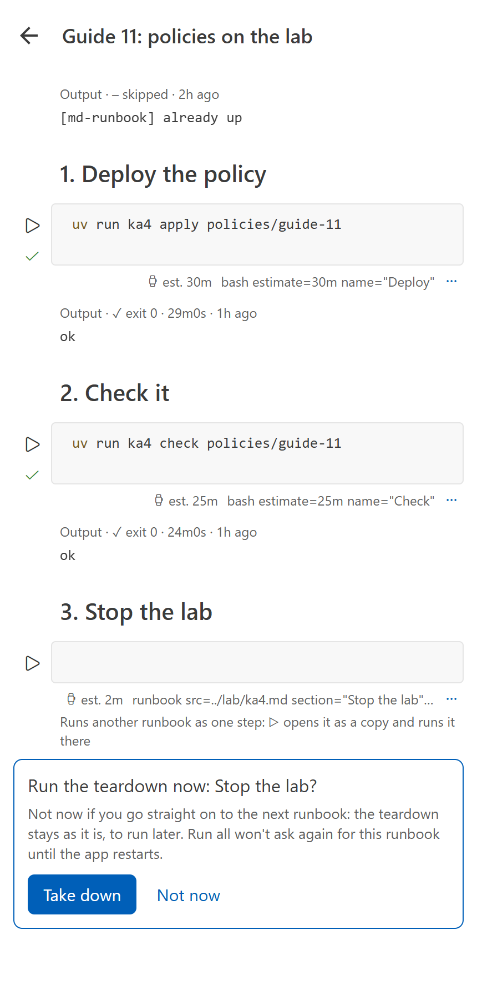
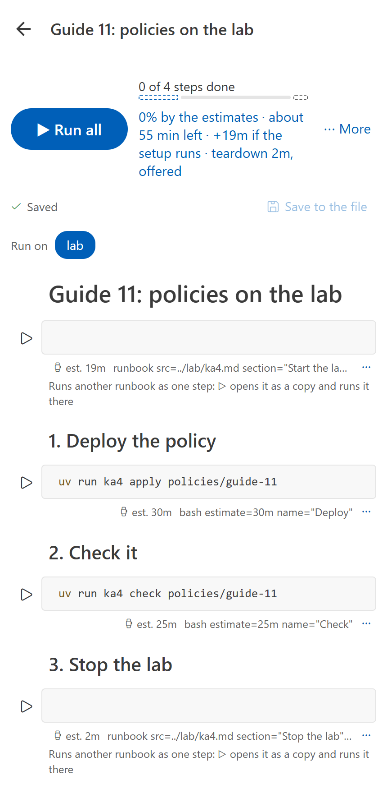

# Setup and teardown

A runbook in a series often starts by bringing something up and ends by taking it down. For
example: a lab cluster, a port-forward, a test stack.

Bringing it up may take 19 minutes when it is down and nothing when the previous runbook left it
running. Taking it down is right when you stop, and wrong when you go straight on to the next
runbook.

Three block options handle this:

| Option | On | Means |
| --- | --- | --- |
| `ready` | a shell block | The **ready check**: exit 0 means *already up*. It never fails a run. One per runbook. |
| `setup` | a block or a runbook call | A **setup step**: skipped when the ready check says up. Setup steps come before the runbook's own steps. |
| `teardown` | a block or a runbook call | A **teardown step**: offered at the end, never run unasked. Teardown steps come last. |

## A resource, defined once

Write what you bring up as a runbook of its own. It has a ready check, a section that starts it
and a section that stops it. Its title is how md-runbook names it.

````markdown
# The lab: Rancher Desktop's Kubernetes (ka4), about 10 GB

```bash ready name="Lab answers"
uv run ka4 ready --quiet
```

## Start the lab

```bash estimate=18m
uv run ka4 up
```

## Stop the lab (its data is kept)

```bash estimate=2m
uv run ka4 down
```
````

Each runbook that needs it calls it ([runbook calls](calls.md)):

````markdown
```runbook src=../lab/ka4.md section="Start the lab" setup
# Runs the runbook ../lab/ka4.md (section Start the lab)
```

…the runbook's own steps…

```runbook src=../lab/ka4.md section="Stop the lab" teardown
# Runs the runbook ../lab/ka4.md (section Stop the lab)
```
````

- A **setup call** runs the ready check of the runbook it calls first, whatever `section=`
  selects. Exit 0: the call is *already up*, nothing else in it runs, and it counts 0 s in the
  progress. Any other exit (or a timeout) runs the section.
- A **teardown call** is offered, not run (see below).
- The check, the setup and the teardown live in one file, so they can't drift apart.
- A signed runbook signs the calls as written; the runbook called is signed on its own. The ready
  check is a signed block like any other, so a server with md-runbook-gate runs it.

## Without a separate file

Setup and teardown steps can be plain blocks, and the runbook can have its own ready check:

````markdown
```bash ready name="the lab"
uv run ka4 ready --quiet
```

## 1. Start the lab

```bash setup estimate=19m
uv run ka4 up
```
…
````

The ready check comes before the setup steps it guards. Without a ready check, setup steps always
run, and the progress reads their estimate as *up to*.

## What happens in a run

| | VS Code (Run All) | The app (Run all) | `md-runbook run` |
| --- | --- | --- | --- |
| Ready check | Runs first; says *already up* or *not up* | The same, on the selected host | The same: `Setup: … is already up - setup skipped` |
| Setup steps, already up | Skipped (`exit=skipped ready=up`) | Skipped | Skipped |
| Teardown steps | Offered at the end, on the first teardown cell: **Take Down** or **Leave It Up** | Offered at the end: **Take down** or **Leave it up** | Not run; `--teardown` runs them after a run that passed, `--teardown=always` after a failure too |

- **Leave it up** leaves the teardown steps as they were (not *skipped*): you can run them by hand
  later. Run All doesn't ask again for that runbook until you reload the VS Code window or restart
  the app. **Resume** (Resume Run) with only the teardown left offers it again.
- `--yes` never runs a teardown: a teardown is a choice about when you stop, not a confirmation.
- A runbook called as one of the steps (not with `setup` or `teardown`) runs whole. Its own setup
  is guarded by its own ready check, and its teardown runs with it.



The ready check's output is kept like any other (`exit=1 check=ok ready=down`): it passed as a
check, whatever it answered.

## Progress

The time left counts the runbook's own steps and the setup while it runs. A teardown counts only
once it is chosen. Before the check, the setup is shown as what it may add:

```text
[....................] 0% · 55 min left · +19m if the setup runs · teardown 2m, offered
[########............] 40% · 33 min left · setup ✓ already up · teardown 2m, offered
```

- **The app** draws one bar in three segments: the setup, the runbook's own steps and the
  teardown. The setup is in a pale accent until the check, and removed when already up. The
  teardown is paler than the track until chosen.

  Under the bar, in words: `0% · 55 min left · ≈ 14:32`. Then a smaller line with the parts:
  `+19m if the setup runs · teardown 2m, offered` (`setup ✓ already up` once the check says up).

  
- **VS Code** shows the parts in the status bar item and, as a table with their times, in its
  tooltip. With the runbook's own steps done and the teardown offered, both read **Done ·
  teardown offered**. Resume Run (the app: Resume) offers the teardown again.
- **`md-runbook run`** tags its step lines `[setup]`, `[teardown]` and `[ready check]`.
- **`md-runbook estimate`** adds a line with the parts:
  `Parts: setup 19m (skipped when already up) · runbook 55m · teardown 2m (offered)`.
- **`--json`** gives every step its `part` (`ready`, `setup`, `body`, `teardown`). The run gets
  a `setup` object with `ready` and `seconds`. `ready`: whether the ready checks said up (missing
  when none ran); `seconds`: how long the setup steps that ran took.

## Resuming

`md-runbook run guide.md --from 23 --setup` resumes at step 23. It runs the ready check and the
setup steps first, so the lab comes back only if it is down. `--setup-always` runs the setup even
when the check says up; `--no-setup` runs neither.

## Lint

Errors:

- a setup step after the runbook's own steps;
- a step after a teardown step;
- a second ready check;
- a ready check after the setup steps;
- a ready check on a runbook call;
- a block marked with two of `setup`, `teardown` and `ready`.
