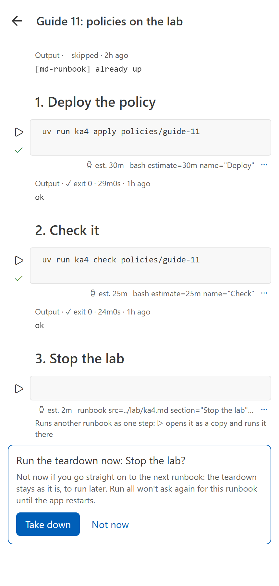
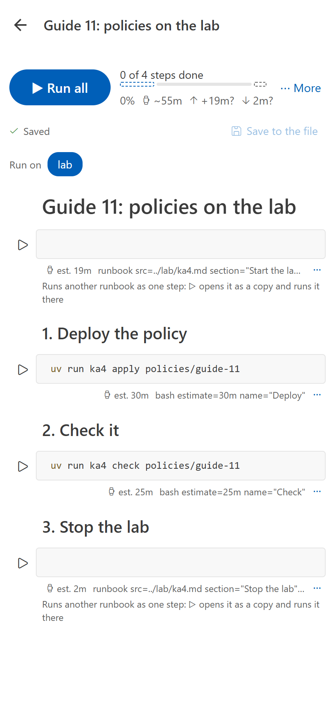

# Setup and teardown

A runbook in a series often starts by bringing something up and ends by taking it down: a lab
cluster, a port-forward, a test stack. Bringing it up may take 19 minutes when it is down and
nothing when the previous runbook left it running. Taking it down is right when you stop, and
wrong when you go straight on to the next runbook.

Three block options handle this:

| Option | On | Means |
| --- | --- | --- |
| `ready` | a shell block | The **ready check**: exit 0 means *already up*. It never fails a run. One per runbook. |
| `setup` | a block or a runbook call | A **setup step**: skipped when the ready check says up. Setup steps come before the runbook's own steps. |
| `teardown` | a block or a runbook call | A **teardown step**: offered at the end, never run unasked. Teardown steps come last. |

## A resource, defined once

Write what you bring up as a runbook of its own: a ready check, a section that starts it, a
section that stops it. Its title is how md-runbook names it.

````markdown
# The lab: Rancher Desktop's Kubernetes (ka4), about 10 GB

```bash ready name="Lab answers"
uv run ka4 ready --quiet
```

## Start the lab

```bash estimate=18m
uv run ka4 up
```

## Stop the lab (its data is kept)

```bash estimate=2m
uv run ka4 down
```
````

Each runbook that needs it calls it ([runbook calls](calls.md)):

````markdown
```runbook src=../lab/ka4.md section="Start the lab" setup
```

…the runbook's own steps…

```runbook src=../lab/ka4.md section="Stop the lab" teardown
```
````

- A **setup call** runs the ready check of the runbook it calls first, whatever `section=`
  selects. Exit 0: the call is *already up*, nothing else in it runs, and it counts 0 s in the
  progress. Any other exit (or a timeout) runs the section.
- A **teardown call** is offered, not run (see below).
- The check, the setup and the teardown live in one file, so they can't drift apart, and a signed
  runbook signs the calls as written and the runbook called on its own: the ready check is a
  signed block like any other, so a server with md-runbook-gate runs it.

## Without a separate file

Setup and teardown steps can be plain blocks, and the runbook can have its own ready check:

````markdown
```bash ready name="the lab"
uv run ka4 ready --quiet
```

## 1. Start the lab

```bash setup estimate=19m
uv run ka4 up
```
…
````

The ready check comes before the setup steps it guards. Without a ready check, setup steps always
run, and the progress reads their estimate as *up to*.

## What happens in a run

| | VS Code (Run All) | The app (Run all) | `md-runbook run` |
| --- | --- | --- | --- |
| Ready check | Runs first; says *already up* or *not up* | The same, on the selected host | The same: `Setup: … is already up - setup skipped` |
| Setup steps, already up | Skipped (`exit=skipped ready=up`) | Skipped | Skipped |
| Teardown steps | Offered at the end: **Take Down** or **Not Now** | Offered at the end: **Take down** or **Not now** | Not run; `--teardown` runs them after a run that passed, `--teardown=always` after a failure too |

- **Not now** leaves the teardown steps as they were (not *skipped*): you can run them by hand
  later. Run All doesn't ask again for that runbook until you reload the VS Code window or restart
  the app; **Continue** (Resume Run) with only the teardown left offers it again.
- `--yes` never runs a teardown: a teardown is a choice about when you stop, not a confirmation.
- A runbook called as one of the steps (not with `setup` or `teardown`) runs whole: its own setup
  is guarded by its own ready check, and its teardown runs with it.



The ready check's output is kept like any other (`exit=1 check=ok ready=down`): it passed as a
check, whatever it answered.

## Progress

The time left counts the runbook's own steps, the setup while it runs, and a teardown only once
it is chosen. Before the check, the setup is shown as what it may add:

```text
[..........] 0% · about 55 min left · +19m if the setup runs · teardown 2m, offered
[####......] 40% · about 33 min left · setup ✓ already up · teardown 2m, offered
```

- **The app** draws one bar in three segments: the setup outlined until the check (removed when
  already up), the runbook's own steps, and the teardown dashed until chosen. Under it, one short
  line with icons: `0% · ⌚ ~55m · ↑ +19m? · ↓ 2m?`. ⌚ is the time left, ↑ the setup, ↓ the
  teardown, and `?` means it may run: the ready check may skip the setup, and the teardown is
  offered, not chosen yet. Once the check says up, ↑ shows `✓ up`. A screen reader reads the
  line in full words.

  
- **VS Code** shows the parts in the status bar item and its tooltip.
- **`md-runbook run`** tags its step lines `[setup]`, `[teardown]` and `[ready check]`.
- **`md-runbook estimate`** adds a line with the parts:
  `Parts: setup 19m (skipped when already up) · runbook 55m · teardown 2m (offered)`.
- **`--json`** gives every step its `part` (`ready`, `setup`, `body`, `teardown`) and the run a
  `setup` object: `ready` (whether the ready checks said up; missing when none ran) and `seconds`
  (how long the setup steps that ran took).

## Resuming

`md-runbook run guide.md --from 23 --setup` resumes at step 23 and runs the ready check and the
setup steps first, so the lab comes back only if it is down. `--setup-always` runs the setup even
when the check says up; `--no-setup` runs neither.

## Lint

Errors: a setup step after the runbook's own steps, a step after a teardown step, a second ready
check, a ready check after the setup steps, a ready check on a runbook call, and a block marked
with two of `setup`, `teardown` and `ready`.
